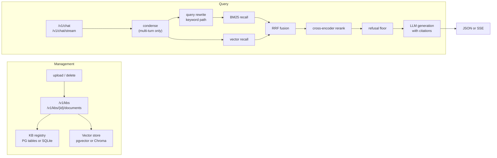

<p align="center">
  
</p>

<h1 align="center">Enterprise Knowledge-base RAG Q&A</h1>

<p align="center">
  A FastAPI service for document-grounded question answering: multiple knowledge bases, hybrid retrieval, cited answers, SSE streaming and multi-turn chat.
</p>

<p align="center">
  English | <a href="README.md">简体中文</a>
</p>


[](https://github.com/zeng-bohan/enterprise-rag-qa/actions/workflows/ci.yml)


The service is API-first. Every capability is a REST endpoint, with interactive Swagger at `/docs`. There is no web console in this version.

## What it does

- Manages knowledge bases and documents. Uploads support PDF, Markdown and TXT; every chunk carries `kb_id` and `doc_id` lineage, so deleting a document or a knowledge base removes its chunks as well.
- Retrieves with BM25 (jieba segmentation) and vector search in parallel, fuses the two rankings with RRF, then reranks the top candidates with a cross-encoder. BM25 uses an inverted index, so a query only visits chunks that contain the query terms.
- Refuses to answer in two places: before generation when nothing is relevant, and after reranking when every candidate falls below the relevance floor. A refusal does not call the LLM.
- Answers with numbered citations. Supports SSE streaming (`citations` → `token*` → `done`) and multi-turn chat, where follow-up questions are condensed into standalone queries before retrieval.
- Offers two storage profiles behind one interface: PostgreSQL + pgvector, or Chroma + a SQLite metadata registry for local use. Switch with `VECTOR_BACKEND`.
- Exposes Prometheus metrics, optional API-key auth and an approximate token-bucket rate limit.

## Architecture



## Evaluation status

Three reports live in `data/`. All were produced by running the pipeline in this repository. Full method and limits: [docs/EVALUATION.md](docs/EVALUATION.md).

| Measurement | Result | Scope |
| --- | --- | --- |
| Retrieval Recall@1 / @3 / @5, hybrid | 87.43% / 97.01% / 97.90% | 334 question rows over 80 distinct gold chunks |
| Retrieval Recall@1 / @3 / @5, vector baseline | 66.17% / 88.92% / 95.21% | the same questions, vector search only |
| RAGAS Faithfulness | 93.27% | stratified sample of 100 rows across 8 documents, 25 distinct chunks |
| RAGAS Answer relevancy | 89.29% | same sample |
| Refusal rate on negatives / false refusal rate | 90% / 4% | 20 out-of-corpus questions, 50 in-corpus questions |

The recall set is synthetic: each question was generated from the chunk it is scored against, so it is easier than real user questions. The RAGAS judge shares a model family with the generator, so self-evaluation bias cannot be ruled out. The negative set has only 20 questions, so the refusal figure indicates a trend rather than a precise rate.

The ANN benchmark is a separate, reproducible experiment. At 50,000 rows across 8 knowledge bases, an exact scan filtered by `kb_id` took about 16 ms with recall 1.0. HNSW under the same filter lost recall as `ef_search` rose, reaching 0.739 at the maximum value of 1000. `ANN_INDEX` therefore defaults to `none`. The benchmark records the execution plan for every measurement, because the planner can switch between HNSW and an exact plan depending on `ef_search`.

## Quick start

### Local mode, no Docker

```bash
python -m venv .venv
.venv/Scripts/python -m pip install -r requirements.txt   # Windows
.venv/bin/python -m pip install -r requirements.txt       # macOS / Linux
cp .env.example .env
```

Windows `cmd` uses `copy .env.example .env` and PowerShell uses `Copy-Item .env.example .env`; the command above works in Git Bash, macOS and Linux.

Set `VECTOR_BACKEND=chroma` and `DEEPSEEK_API_KEY` in `.env`. This profile uses Chroma plus a local SQLite registry and does not need PostgreSQL or Redis.

```bash
.venv/Scripts/python scripts/ingest_docs.py
.venv/Scripts/python -m uvicorn app.main:app --host 127.0.0.1 --port 8000
```

On macOS or Linux, replace the interpreter with `.venv/bin/python`.

The first startup downloads the embedding model (about 95 MB) and the reranker (about 1.1 GB) into the fastembed cache. Both run locally through ONNX Runtime. If the embedding model cannot be downloaded, startup fails; if the reranker fails, it degrades to no reranking and the service still runs.

### PostgreSQL and Redis

```bash
docker compose up -d
```

This starts PostgreSQL with pgvector, Redis, and an ingestion worker. It does not start the API. Set `VECTOR_BACKEND=pgvector` and make sure `POSTGRES_DSN` and `REDIS_URL` point at the mapped ports, then run the Uvicorn command above on the host.

Ingestion is synchronous by default. For queued ingestion, set `INGEST_MODE=queue` on both the API and the worker.

## API

| Method | Path | Purpose |
| --- | --- | --- |
| POST | `/v1/chat` | Answer a question; accepts `kb_id` and `history` |
| POST | `/v1/chat/stream` | Same, as SSE |
| POST | `/v1/kbs` | Create a knowledge base |
| GET | `/v1/kbs` | List knowledge bases with document and chunk counts |
| DELETE | `/v1/kbs/{kb_id}` | Delete a knowledge base and its chunks |
| POST | `/v1/kbs/{kb_id}/documents` | Upload and index a document |
| GET | `/v1/kbs/{kb_id}/documents` | List documents |
| DELETE | `/v1/kbs/{kb_id}/documents/{doc_id}` | Delete a document and its chunks |
| POST | `/v1/retrieval-test` | Retrieval only, without generation |
| GET | `/health`, `/metrics` | Health check and Prometheus metrics |

When `API_KEYS` is set, every `/v1` route requires `X-API-Key`. `/health` and `/metrics` stay open.

```bash
curl -X POST http://127.0.0.1:8000/v1/chat \
  -H "Content-Type: application/json" \
  -d '{"question":"员工请年假需要提前几天申请？"}'
```

## Tests

The suite has two halves.

```bash
pip install -r requirements.txt -r requirements-dev.txt

pytest tests -m "not contract" -q      # 134 offline tests, no database, no model downloads
docker compose up -d
RAG_CONTRACT_STRICT=1 pytest tests -m contract -q   # 42 contract tests against real backends
```

The offline half stubs the LLM, reranker, vector store, registry and cache, so it runs in about ten seconds and covers orchestration, refusal, caching, streaming and concurrency. It cannot see SQL. The contract half runs the same assertions against PostgreSQL/pgvector and Chroma: lifecycle, cascade deletion, per-KB isolation and score-scale parity. In CI, a missing PostgreSQL fails the job instead of skipping it.

CI runs both halves on Python 3.12.

## Project layout

```text
app/
├── main.py              FastAPI app and lifespan
├── config.py            pydantic-settings configuration
├── api/                 chat, knowledge-base management, error translation
├── core/                auth, cache, embeddings, executor, metrics, queue, versioning
└── rag/                 loader, chunker, BM25, vector store, retriever, reranker,
                         generator, pipeline, registry, ingestion
scripts/                 ingestion, CLI questions, evaluation and benchmarks
tests/                   offline tests
tests/contract/          dual-backend contract tests
data/docs/               sample corpus
data/qa_set/, data/bench evaluation sets and reports
docs/                    design decisions, evaluation method, technical highlights
```

## Design notes

- [docs/DESIGN.md](docs/DESIGN.md): 17 design decisions, including model and store choices, chunking, hybrid retrieval, refusal, cache keys, streaming protocol and the ANN measurement.
- [docs/TECHNICAL_HIGHLIGHTS.md](docs/TECHNICAL_HIGHLIGHTS.md): what each subsystem solves, where the code is, how to verify it, and what it does not handle.
- [docs/EVALUATION.md](docs/EVALUATION.md): evaluation method, sample composition, known biases and what is still unverified.

## Limitations

- BM25 lives in process memory. After a knowledge-base change the index is reloaded; tokenization is cached, but loading and rebuilding remain O(N) per knowledge base. A database-side inverted index (tsvector + GIN) is the next step for very large corpora.
- The local profile (Chroma + SQLite) has no cross-engine transaction. A failed ingestion is compensated by marking the document `failed`, which can leave a short window where metadata and chunks disagree.
- Retrieval thresholds and ANN settings are tuned for the corpus in `data/docs`. Different corpora need re-measurement.
- There is no document-level access control. API keys gate the whole service, not individual knowledge bases.
- PDF text extraction needs an embedded text layer. Scanned PDFs and PDFs with fonts that lack a ToUnicode map will produce garbled or empty text; the ingestion path reports the failure instead of indexing noise.
- The rate limiter is an approximate per-second counter in Redis. It is meant to stop obvious abuse, not to enforce precise quotas.

## License

[MIT](LICENSE)
