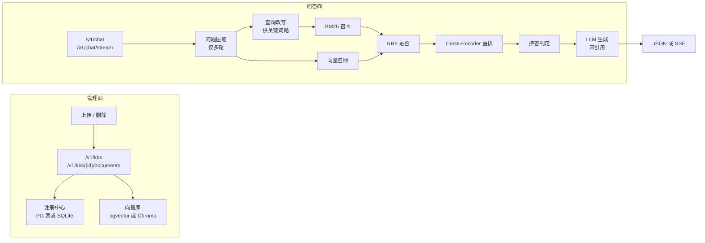

<p align="center">
  
</p>

<h1 align="center">企业知识库 RAG 问答</h1>

<p align="center">
  基于 FastAPI 的文档问答服务：多知识库、混合检索、引用溯源、SSE 流式与多轮对话。
</p>

<p align="center">
  <a href="README.md">English</a> | 简体中文
</p>


[](https://github.com/zeng-bohan/enterprise-rag-qa/actions/workflows/ci.yml)


服务以 API 为先，所有能力都通过 REST 端点提供，交互式文档在 `/docs`。当前版本没有 Web 控制台。

## 功能

- 知识库与文档管理。支持 PDF、Markdown、TXT 上传，每个 chunk 都带 `kb_id` 与 `doc_id` 血缘，删除文档或知识库会一并清理对应 chunk。
- 混合检索。BM25（jieba 分词）与向量检索并行召回，用 RRF 融合排名，再交给 Cross-Encoder 重排。
- 两处拒答。检索后没有任何相关命中时直接拒答，不调用生成模型；重排后所有候选都低于相关度下限时同样拒答。
- 引用问答。回答标注编号，SSE 事件顺序为 `citations`、`token*`、`done`。多轮对话会先把追问改写成独立问题再检索。
- 两种存储形态共用一个接口：PostgreSQL + pgvector，或 Chroma + SQLite 元数据注册中心。通过 `VECTOR_BACKEND` 切换。
- Prometheus 指标、可选 API Key 鉴权、近似令牌桶限流。

## 架构



## 评测现状

`data/` 下有两份评测报告，都是在本仓库跑出来的，读数字前需要先看口径。

| 指标 | 结果 | 口径 |
| --- | --- | --- |
| 检索 Recall@1 / @3 / @5 | 87.4% / 97.9% / 98.2% | 334 行问题，覆盖 80 个唯一 gold chunk，行级平均 |
| RAGAS Faithfulness | 94.1% | 100 行，全部来自同一份源文档，评审模型与生成模型同族 |
| RAGAS Answer relevancy | 88.7% | 同上 |

召回评测集是合成的：问题由被评分的 chunk 正文生成，比真实用户提问容易。RAGAS 子集只覆盖 24 个唯一 chunk，评审用的 DeepSeek 与生成模型同族，自评偏差无法排除。两个数字描述的是这套管线在这批语料上的表现，不能当作系统整体质量。

ANN 基准是另一组可复现实验。结论是：在测试规模下，带 `kb_id` 过滤的精确扫描已经够快，而 HNSW 在同样过滤下会丢召回，因此 `ANN_INDEX` 默认 `none`。基准会记录每次测量实际走到的执行计划，因为规划器会随 `ef_search` 在 HNSW 与精确计划之间切换。

方法、复现命令与完整限制见 [docs/EVALUATION.md](docs/EVALUATION.md)。

## 快速开始

### 本地模式，不需要 Docker

```bash
python -m venv .venv
.venv/Scripts/python -m pip install -r requirements.txt   # Windows
.venv/bin/python -m pip install -r requirements.txt       # macOS / Linux
cp .env.example .env
```

Windows `cmd` 用 `copy .env.example .env`，PowerShell 用 `Copy-Item .env.example .env`；上面的写法适用于 Git Bash、macOS 与 Linux。

在 `.env` 中设置 `VECTOR_BACKEND=chroma` 和 `DEEPSEEK_API_KEY`。该形态使用 Chroma 加本地 SQLite 注册中心，不需要 PostgreSQL 与 Redis。

```bash
.venv/Scripts/python scripts/ingest_docs.py
.venv/Scripts/python -m uvicorn app.main:app --host 127.0.0.1 --port 8000
```

macOS 或 Linux 将解释器换成 `.venv/bin/python`。

首次运行会下载嵌入模型（约 95MB），用到重排时再下载重排模型（约 1.1GB），都缓存在 fastembed 目录，通过 ONNX Runtime 在本机推理。

### PostgreSQL 与 Redis

```bash
docker compose up -d
```

会启动带 pgvector 的 PostgreSQL、Redis 和摄取 worker，不启动 API 本体。在 `.env` 中设置 `VECTOR_BACKEND=pgvector`，确认 `POSTGRES_DSN` 与 `REDIS_URL` 指向映射端口，然后在宿主机运行上面的 Uvicorn 命令。

同步摄取是默认模式。使用队列时，API 与 worker 两侧都要设置 `INGEST_MODE=queue`。

## API

| 方法 | 路径 | 用途 |
| --- | --- | --- |
| POST | `/v1/chat` | 问答，支持 `kb_id` 与 `history` |
| POST | `/v1/chat/stream` | SSE 流式问答 |
| POST | `/v1/kbs` | 创建知识库 |
| GET | `/v1/kbs` | 列出知识库及文档、chunk 数 |
| DELETE | `/v1/kbs/{kb_id}` | 删除知识库及其 chunk |
| POST | `/v1/kbs/{kb_id}/documents` | 上传并索引文档 |
| GET | `/v1/kbs/{kb_id}/documents` | 列出文档 |
| DELETE | `/v1/kbs/{kb_id}/documents/{doc_id}` | 删除文档及其 chunk |
| POST | `/v1/retrieval-test` | 只检索，不生成 |
| GET | `/health`、`/metrics` | 健康检查与 Prometheus 指标 |

配置 `API_KEYS` 后，所有 `/v1` 路由需要 `X-API-Key`。`/health` 与 `/metrics` 始终开放。

```bash
curl -X POST http://127.0.0.1:8000/v1/chat \
  -H "Content-Type: application/json" \
  -d '{"question":"员工请年假需要提前几天申请？"}'
```

## 测试

测试分成两半。

```bash
pip install -r requirements.txt -r requirements-dev.txt

pytest tests -m "not contract" -q      # 127 个离线用例，不连数据库、不下载模型
docker compose up -d
RAG_CONTRACT_STRICT=1 pytest tests -m contract -q   # 42 个契约用例，真实后端
```

离线套件打桩了 LLM、重排器、向量库、注册中心与缓存，几秒跑完，覆盖编排、拒答、缓存、流式与并发关系，但看不见 SQL。契约套件对 PostgreSQL/pgvector 与 Chroma 跑同一组断言，覆盖生命周期、级联删除、按库隔离与分数口径一致。CI 中缺少 PostgreSQL 会判失败，不会跳过。

CI 在 Python 3.12 上运行这两组测试。

## 目录结构

```text
app/
├── main.py              FastAPI 应用与 lifespan
├── config.py            pydantic-settings 配置
├── api/                 问答、知识库管理、异常翻译
├── core/                鉴权、缓存、嵌入、执行器、指标、队列、版本号
└── rag/                 解析、切片、BM25、向量库、检索、重排、
                         生成、编排、注册中心、摄取
scripts/                 入库、命令行提问、评测与基准
tests/                   离线测试
tests/contract/          双后端契约测试
data/docs/               示例语料
data/qa_set/, data/bench 评测集与报告
docs/                    设计决策、评测方法、技术导览
```

## 设计文档

- [docs/DESIGN.md](docs/DESIGN.md)：17 个设计决策，包括模型与存储选型、切片、混合检索、拒答、缓存键、流式协议与 ANN 测量。
- [docs/TECHNICAL_HIGHLIGHTS.md](docs/TECHNICAL_HIGHLIGHTS.md)：每个子系统解决什么问题、代码在哪、怎么验证、不覆盖什么。
- [docs/EVALUATION.md](docs/EVALUATION.md)：评测方法、样本组成、已知偏差与尚未验证的结论。

## 已知限制

- BM25 索引在进程内存中，知识库变更后全量重建。大知识库在首次查询时会出现延迟尖刺。
- 本地形态（Chroma + SQLite）没有跨引擎事务。摄取失败靠标记 `failed` 补偿，元数据与 chunk 可能短暂不一致。
- 检索阈值与 ANN 参数按 `data/docs` 的语料调过，换语料需要重新测量。
- 没有文档级访问控制。API Key 控制整个服务，不能区分知识库。
- PDF 解析依赖文本层。扫描件或缺少 ToUnicode 映射的字体会得到乱码或空文本，摄取流程会报失败，不会把噪声写进索引。
- 限流是 Redis 上的近似按秒计数，用于阻挡明显滥用，不能当作精确配额。

## 许可证

[MIT](LICENSE)
